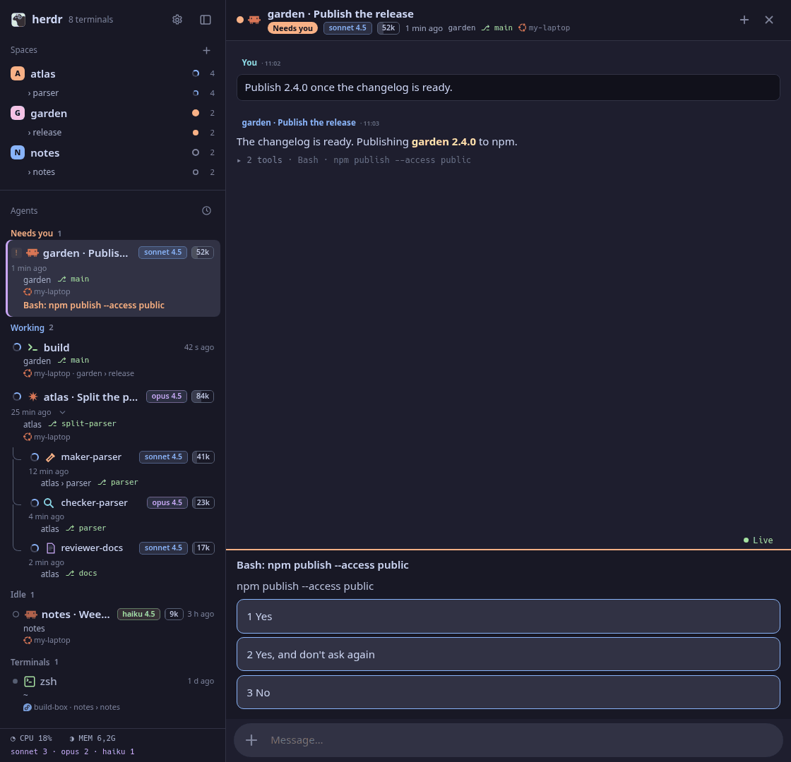
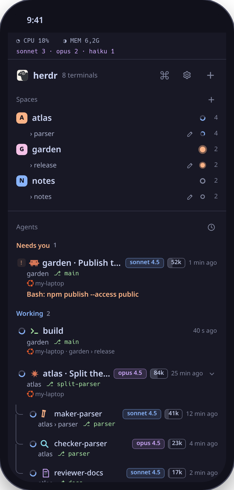
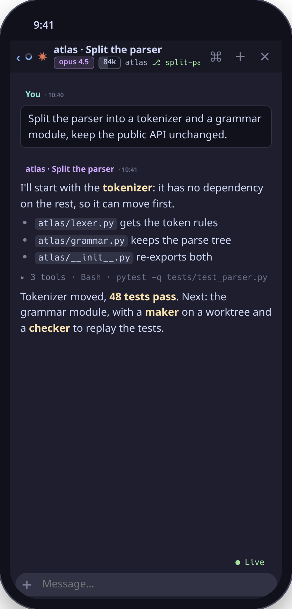
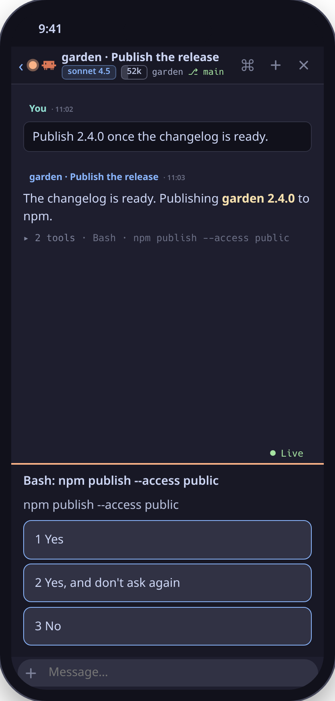
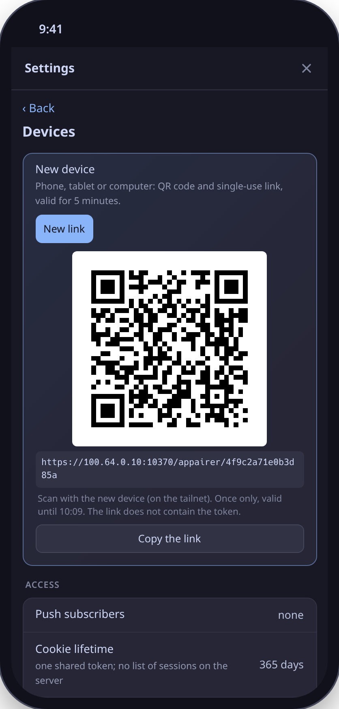
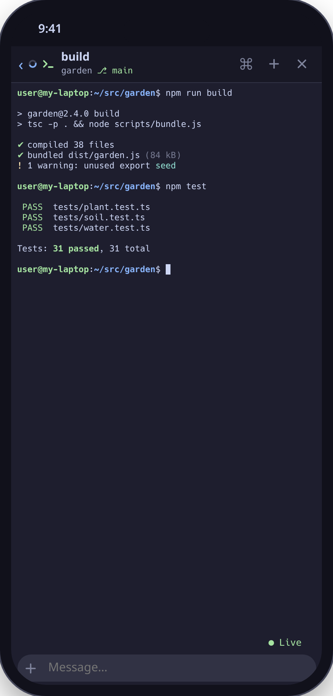

**Français** · [English](README.md)

# herdr-web

> **Projet non officiel de herdr.** herdr-web est un compagnon indépendant de
> [herdr](https://herdr.dev) (herdr-core et herdr-app) ; il n'est ni écrit ni cautionné par les auteurs de herdr.

Un petit serveur web Python pour piloter ses agents herdr-core (surtout Claude Code) depuis un
téléphone : voir quel agent vous attend, lire sa conversation, lui répondre par écrit ou à la voix,
recevoir une notification quand l'un d'eux est bloqué.

Il tourne sur la machine des agents, en unit systemd **utilisateur**, en HTTPS, derrière un jeton
d'accès unique. Il est fait pour être joint depuis un réseau privé (Tailscale ou réseau local), pas
depuis Internet.

On s'en sert sur **téléphone, tablette ou ordinateur**. Sur ordinateur, préférez **[herdr-app](https://herdr.dev)**,
la fenêtre native : elle est plus complète (spaces, panes, mods). herdr-web sert surtout quand on est
loin de son poste.

La page est en anglais par défaut ; le français se choisit dans Réglages › Affichage.

## Prérequis

Le flake Nix ne déclare que `x86_64-linux`. Sur une autre architecture, suivre la voie « sans Nix »
ci-dessous (un virtualenv Python).

| Quoi | Pourquoi | Obligatoire |
|------|----------|-------------|
| Linux avec systemd (units utilisateur) | le service est une unit `systemd --user` | oui |
| **herdr-core**, sa commande `hc` dans le `PATH` (herdr-app en est la fenêtre) | herdr-web parle aux agents par `hc connect` | oui |
| **Claude Code** | les agents affichés et pilotés sont des sessions Claude Code | oui |
| **Python 3** avec `pywebpush` et `cryptography` — par **Nix** (le flake les fournit) ou un virtualenv | le serveur et l'installeur | oui |
| **ffmpeg** | convertit les messages vocaux avant transcription | pour la voix |
| **Handy** (transcription locale), trouvé par `~/.config/autostart/Handy.desktop` | transforme un message vocal en texte | facultatif |
| **Tailscale** (ou un réseau local privé) | permet au téléphone de joindre la machine sans l'exposer | vivement conseillé |

Testé avec Python 3.14, `cryptography` 50, `hc` 0.1.21, sous NixOS.

## Laisser son agent l'installer

Donnez ceci à Claude Code, Codex, opencode ou tout agent de code, depuis un clone de ce dépôt :

> Lis `AGENTS.md`, puis installe herdr-web sur cette machine : lance d'abord la simulation et montre-la-moi,
> lie-le à mon adresse Tailscale, n'affiche jamais le jeton d'accès, et demande-moi avant d'ouvrir quoi que
> ce soit au-delà de mon réseau privé.

[`AGENTS.md`](AGENTS.md) (en anglais) est la version pas à pas pour les agents (vérification des prérequis,
installeur, contrôles d'après installation, règles de sûreté) ; il explique aussi comment contribuer
(organisation du code, tests, règles que la suite de tests impose). Claude Code le lit grâce au `CLAUDE.md`
d'une ligne qui l'importe.

## Depuis son téléphone, par Tailscale

1. Installer [Tailscale](https://tailscale.com) sur la machine qui fait tourner herdr-core **et** sur
   le téléphone, et connecter les deux au même tailnet.
2. Sur la machine, lire son adresse dans le tailnet : `tailscale ip -4` (par exemple `100.64.0.10`).
3. Installer herdr-web à l'écoute de cette adresse (voir [Installation](#installation)) :
   `python3 deploy/installer.py --go --bind 100.64.0.10:10370 --cert-autosigne`.
4. Sur le téléphone, Tailscale actif, ouvrir `https://100.64.0.10:10370/`, accepter l'avertissement
   de certificat, saisir le jeton d'accès une fois.
5. Ajouter la page à l'écran d'accueil. Les agents qui vous attendent viennent en tête ; toucher l'un
   d'eux pour lire sa conversation et lui répondre, par écrit ou à la voix.
6. Pour les notifications, utiliser un certificat reconnu par le téléphone (voir
   [Certificat](#certificat)) et les autoriser dans les Réglages.

Rien n'est exposé à Internet : seuls les appareils de votre tailnet joignent la page.

 

<table>
<tr>
<td align="center"> Un agent et sa conversation</td>
<td align="center"> Une question, une réponse d'un toucher</td>
<td align="center"> Appairer un nouvel appareil</td>
<td align="center"> Un terminal en direct</td>
</tr>
</table>

## Installation

Sans `--go`, l'installeur **simule** : il liste ses pré-conditions et chaque geste, et n'écrit rien.
Lire cette sortie avant de l'exécuter pour de bon. Ses messages sont en anglais.

1. Cloner le dépôt à un endroit où il restera (la unit pointe vers lui) :

       git clone <URL du dépôt> ~/herdr-web && cd ~/herdr-web

2. Choisir la ou les adresses d'écoute. Par défaut, seulement `127.0.0.1:10370`, injoignable depuis
   un téléphone. Pour passer par Tailscale, prendre l'adresse Tailscale de la machine
   (`tailscale ip -4`) :

       python3 deploy/installer.py --bind 100.x.y.z:10370 --cert-autosigne

   Plusieurs adresses se séparent par des virgules (`--bind 100.x.y.z:10370,127.0.0.1:10370`).

   Le serveur ne répond qu'aux requêtes dont le `Host` (le nom ou l'adresse tapé dans le
   navigateur) figure dans sa liste. Par défaut cette liste est déduite de `--bind` : une adresse
   précise est acceptée telle quelle, `127.0.0.1` donne `localhost` et `127.0.0.1`, et une écoute
   joker (`0.0.0.0`) ne donne que le nom de la machine et `localhost` — **pas** ses adresses IP. Si
   le téléphone passe par un autre nom ou une autre adresse (nom DNS ou Tailscale, IP du réseau
   local derrière une écoute joker), l'ajouter avec `--hosts`, par exemple
   `--hosts 192.168.1.20:10370,box.tail1234.ts.net:10370`.

3. L'exécuter pour de bon, mêmes options plus `--go`.

   - **Avec Nix** (le flake construit l'environnement Python) :

         nix develop -c python3 deploy/installer.py --go --bind 100.x.y.z:10370 --cert-autosigne

   - **Sans Nix** : créer d'abord l'environnement Python, puis lancer l'installeur avec lui :

         python3 -m venv ~/.local/share/herdr-web/pyenv
         ~/.local/share/herdr-web/pyenv/bin/pip install pywebpush cryptography
         ~/.local/share/herdr-web/pyenv/bin/python deploy/installer.py --go --bind 100.x.y.z:10370 --cert-autosigne

   L'installeur génère en mémoire le jeton d'accès et la clé de notification (VAPID), les écrit dans
   `~/.config/herdr-web/env` (fichier `600`, dossier `700`), crée un certificat autosigné dans
   `~/.config/herdr-web/tls/`, pose `~/.config/systemd/user/herdr-web.service` et le démarre.

   Hors NixOS, le `PATH` de la unit est construit à partir des dossiers où `hc` et `ffmpeg` ont été
   trouvés, plus les dossiers système habituels ; `--unit-path` le fixe explicitement. Un outil
   trouvé seulement sous `/nix/store` (par exemple le `ffmpeg` que fournit `nix develop`) est
   écarté, avec un avertissement : ce dossier disparaît au prochain `nix-collect-garbage`.
   Installer un tel outil au niveau du système ou dans son profil Nix
   (`nix profile install nixpkgs#ffmpeg`).

4. Vérifier qu'il tourne :

       systemctl --user is-active herdr-web
       journalctl --user -u herdr-web -n 20

   Pour qu'il tourne aussi session fermée : `loginctl enable-linger $USER`.

Relancer l'installeur est sans risque : si `~/.config/herdr-web/env` existe, ni le jeton ni la clé
ne sont régénérés ; seuls les `--bind`, `--hosts` ou `--vapid-subject` passés explicitement sont
réécrits, et la unit est reposée.

### Certificat

`--cert-autosigne` fabrique un certificat autosigné valable un an, pour les noms de `--hosts` (ou,
si le fichier env existe déjà, pour le `HERDR_WEB_HOSTS` qu'il porte). Pour le renouveler, retirer
`~/.config/herdr-web/tls/cert.pem` et `key.pem`, puis relancer l'installeur avec
`--go --cert-autosigne`.

Le navigateur du téléphone avertira une fois, et **les notifications exigent un certificat reconnu
par le navigateur**. Pour elles, poser un vrai certificat et sa clé dans
`~/.config/herdr-web/tls/cert.pem` et `~/.config/herdr-web/tls/key.pem` **avant** l'installation
(sans `--cert-autosigne`). Avec Tailscale (certificats HTTPS activés pour le tailnet) :

    cd ~/.config/herdr-web/tls   # à créer en mode 700 si besoin
    tailscale cert --cert-file cert.pem --key-file key.pem <machine>.<tailnet>.ts.net
    chmod 600 key.pem

puis passer ce nom dans `--hosts`. Un certificat Tailscale dure **90 jours** et rien ici ne le
renouvelle : relancer la même commande `tailscale cert` avant l'échéance (un timer ou une tâche
cron mensuelle s'en charge), puis `systemctl --user restart herdr-web`.

### Secrets dans un coffre Vaultwarden (facultatif)

Avec `--org-id <organisation> --collection-id <collection>`, l'installeur range d'abord le jeton et
la clé dans un item `herdr-web` d'une organisation Vaultwarden/Bitwarden, le relit et compare les
empreintes, et seulement alors écrit le fichier env. Ce mode n'imprime aucun secret.

Il demande une commande `bw-unlocked` dans le `PATH` : une enveloppe de la CLI Bitwarden `bw` qui
prend les mêmes arguments, les exécute avec une session déverrouillée (`BW_SESSION`) et rend la
sortie de `bw`, code de retour compris. L'installeur appelle `sync`, `list items --search herdr-web`,
`get template item`, `create item <JSON en base64>` et `get item <id>`. Une version minimale :

    #!/bin/sh
    exec bw --session "$BW_SESSION" "$@"

## Le jeton d'accès

En mode local (par défaut), le jeton est affiché **une seule fois**, à la fin d'un `--go` réussi.
Le garder dans un gestionnaire de mots de passe. Pour le relire depuis le fichier env :

    grep '^HERDR_WEB_TOKEN=' ~/.config/herdr-web/env | cut -d= -f2-

Qui détient ce jeton pilote vos agents : ne le collez ni dans une discussion, ni dans un ticket, ni
dans un journal.

## Connecter un appareil

1. Mettre le téléphone sur le même réseau privé (appli Tailscale connectée à votre tailnet, ou le
   réseau local).
2. Ouvrir `https://<adresse>:10370/` (l'adresse donnée à `--bind`, ou le nom donné à `--hosts`).
3. Accepter l'avertissement de certificat si vous avez utilisé `--cert-autosigne`.
4. Saisir le jeton d'accès une fois. Le serveur pose un cookie `HttpOnly` valable un an ; le jeton
   n'est plus demandé sur cet appareil.
5. Facultatif : ajouter la page à l'écran d'accueil, puis autoriser les notifications depuis le
   panneau des réglages (roue crantée).

Pour déconnecter un appareil : bouton « Déconnexion » des réglages ; pour déconnecter **tous** les
appareils : changer le jeton (ci-dessous).

## Saisie vocale (facultatif)

Le bouton micro envoie un message vocal que [Handy](https://github.com/cjpais/Handy), une application
libre de transcription séparée, transforme en texte **en local** : herdr-web la trouve par
`~/.config/autostart/Handy.desktop` et lance sa transcription en ligne de commande (avec `ffmpeg` pour
convertir l'audio). Aucun son ne part vers un service en ligne. Sans Handy, tout fonctionne sauf le
micro. Réglages › Voix peut importer le modèle, la langue et le vocabulaire de Handy.

## Changer le jeton

Arrêter le service, noter les réglages actuels, retirer le fichier env, relancer l'installeur avec
**les mêmes** `--bind`, `--hosts` et `--vapid-subject` (sinon `--hosts` retombe sur sa valeur par
défaut, et le serveur refuse les noms qu'il ne liste plus). Un nouveau jeton et une nouvelle clé de
notification sont générés : les appareils doivent se reconnecter et réactiver les notifications.

    systemctl --user stop herdr-web
    grep -E '^HERDR_WEB_(BIND|HOSTS|VAPID_SUBJECT)=' ~/.config/herdr-web/env   # noter ces valeurs
    rm ~/.config/herdr-web/env

    # avec Nix
    nix develop -c python3 deploy/installer.py --go --bind <BIND> --hosts <HOSTS> --vapid-subject <VAPID_SUBJECT>
    # sans Nix
    ~/.local/share/herdr-web/pyenv/bin/python deploy/installer.py --go --bind <BIND> --hosts <HOSTS> --vapid-subject <VAPID_SUBJECT>

## Quota Claude dans la barre d'état (facultatif)

La barre d'état mesure elle-même le CPU et la mémoire (depuis `/proc`, Linux seulement ; `—` ailleurs).
Un troisième segment, le quota de votre plan Claude, n'apparaît que si vous donnez à herdr-web un script
qui l'affiche : ajoutez `"quota_script": "/chemin/absolu/du/script"` dans
`~/.config/herdr-web/reglages.json`. Le script tourne toutes les 60 s tant qu'une page est ouverte,
directement s'il est exécutable, sinon avec le Python de herdr-web ; la première ligne qu'il écrit est
affichée telle quelle (`—` s'il échoue). Aucun redémarrage n'est nécessaire. La page ne peut ni lire ni
modifier ce réglage.

## Désinstaller

    systemctl --user disable --now herdr-web.service
    rm ~/.config/systemd/user/herdr-web.service
    systemctl --user daemon-reload
    rm -r ~/.config/herdr-web ~/.local/state/herdr-web ~/.local/share/herdr-web

puis supprimer le dépôt cloné. Rien d'autre n'est installé.

## Développement

    nix develop -c pytest -q

## Images

`docs/media/agents.gif` et les images `docs/media/phone*.png` sont fabriqués à partir de données
synthétiques par `tools/presentation/make.sh` (Chromium sans tête et ffmpeg) ; voir
`tools/presentation/README.md`.

## Licence

MIT — voir [LICENSE](LICENSE). Le code tiers garde sa licence : `static/vendor/xterm/` (MIT),
`static/vendor/qrcode/` (Apache-2.0, voir son fichier LICENSE) ;
et les icônes de `static/os/` viennent de Simple Icons (CC0) ou sont originales ; les logos restent des
marques de leurs propriétaires (voir `static/os/LICENSE-simple-icons.txt`).
