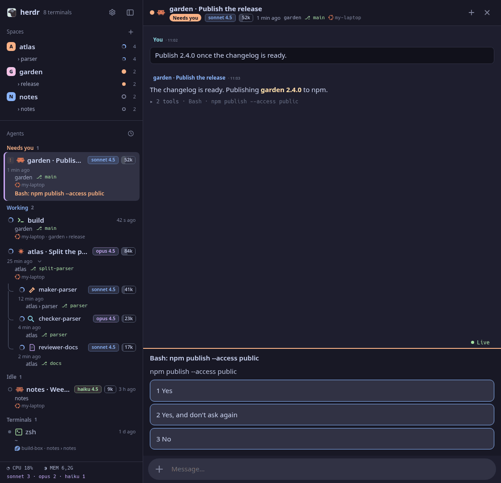
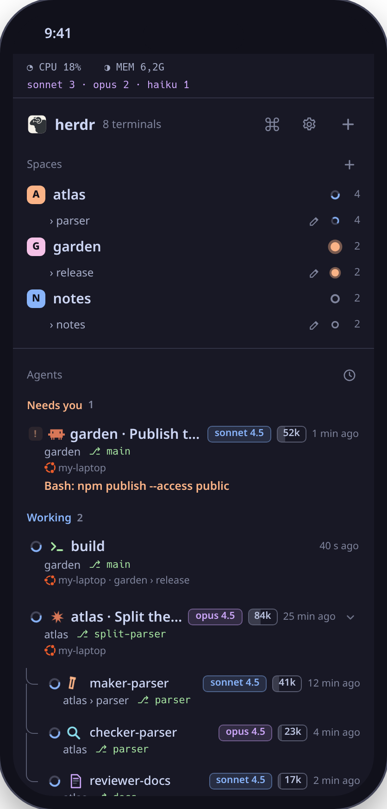

[Français](README.fr.md) · **English**

# herdr-web

> **Not an official herdr project.** herdr-web is an independent companion to
> [herdr](https://herdr.dev) (herdr-core and herdr-app); it is not made or endorsed by the herdr authors.

A small Python web server to drive your herdr-core agents (Claude Code, mostly) from a phone:
see which agent is waiting for you, read its conversation, answer it by text or by voice, get a
push notification when one is blocked.

It runs on the machine where the agents run, as a systemd **user** unit, over HTTPS, behind a
single access token. It is meant to be reached from a private network (Tailscale or a LAN), not
from the Internet.

The page is in English by default; French can be chosen in Settings › Display.

## Requirements

The Nix flake only declares `x86_64-linux`. On another architecture, use the "without Nix" path
below (a Python virtualenv).

| What | Why | Required |
|------|-----|----------|
| Linux with systemd (user units) | the service is a `systemd --user` unit | yes |
| **herdr-core**, its `hc` command in the `PATH` (herdr-app is its window) | herdr-web talks to the agents through `hc connect` | yes |
| **Claude Code** | the agents shown and driven are Claude Code sessions | yes |
| **Python 3** with `pywebpush` and `cryptography` — through **Nix** (the flake provides them) or a virtualenv | the server and the installer | yes |
| **ffmpeg** | converts voice notes before transcription | for voice |
| **Handy** (local transcription), found through `~/.config/autostart/Handy.desktop` | turns a voice note into text | optional |
| **Tailscale** (or a private LAN) | lets the phone reach the machine without exposing it | strongly advised |

Tested with Python 3.14, `cryptography` 50, `hc` 0.1.21, on NixOS.

## Use it from your phone over Tailscale

1. Install [Tailscale](https://tailscale.com) on the machine that runs herdr-core **and** on your
   phone, and log both into the same tailnet.
2. On the machine, read its tailnet address: `tailscale ip -4` (say `100.64.0.10`).
3. Install herdr-web listening on that address (see [Install](#install)):
   `python3 deploy/installer.py --go --bind 100.64.0.10:10370 --cert-autosigne`.
4. On the phone, with Tailscale on, open `https://100.64.0.10:10370/`, accept the certificate
   warning, and type the access token once.
5. Add the page to the home screen. Agents that need you come first; tap one to read its
   conversation and answer it, by text or by voice.
6. For push notifications, use a certificate the phone trusts (see [Certificate](#certificate)) and
   allow them in Settings.

Nothing is exposed to the Internet: only devices of your tailnet reach the page.

 

## Install

The installer only **simulates** unless given `--go`: it lists its preconditions and every step,
and writes nothing. Read that output before running it for real.

1. Clone the repository somewhere it will stay (the unit points to it):

       git clone <repository URL> ~/herdr-web && cd ~/herdr-web

2. Choose the address(es) the server listens on. By default it only listens on `127.0.0.1:10370`,
   which a phone cannot reach. To reach it over Tailscale, use the machine's Tailscale address
   (`tailscale ip -4`):

       python3 deploy/installer.py --bind 100.x.y.z:10370 --cert-autosigne

   Several addresses are separated by commas (`--bind 100.x.y.z:10370,127.0.0.1:10370`).

   The server answers only requests whose `Host` (the name or address typed in the browser) is in
   its list. By default that list is derived from `--bind`: a specific address is accepted as is,
   `127.0.0.1` gives `localhost` and `127.0.0.1`, and a wildcard bind (`0.0.0.0`) gives only the
   machine's hostname and `localhost` — **not** its IP addresses. If the phone will use another
   name or address (a DNS or Tailscale name, the LAN IP behind a wildcard bind), list it with
   `--hosts`, e.g. `--hosts 192.168.1.20:10370,box.tail1234.ts.net:10370`.

3. Run it for real, with the same options plus `--go`.

   - **With Nix** (the flake builds the Python environment):

         nix develop -c python3 deploy/installer.py --go --bind 100.x.y.z:10370 --cert-autosigne

   - **Without Nix**: create the Python environment first, then run the installer with it:

         python3 -m venv ~/.local/share/herdr-web/pyenv
         ~/.local/share/herdr-web/pyenv/bin/pip install pywebpush cryptography
         ~/.local/share/herdr-web/pyenv/bin/python deploy/installer.py --go --bind 100.x.y.z:10370 --cert-autosigne

   The installer generates the access token and the push (VAPID) key in memory, writes them to
   `~/.config/herdr-web/env` (file `600`, folder `700`), creates a self-signed certificate in
   `~/.config/herdr-web/tls/`, installs `~/.config/systemd/user/herdr-web.service` and starts it.

   Outside NixOS, the unit's `PATH` is built from the folders where `hc` and `ffmpeg` were found,
   plus the usual system folders; `--unit-path` sets it explicitly. A tool found only under
   `/nix/store` (for instance the `ffmpeg` that `nix develop` provides) is left out, with a warning:
   that folder disappears at the next `nix-collect-garbage`. Install such a tool system-wide or in
   your Nix profile (`nix profile install nixpkgs#ffmpeg`).

4. Check it runs:

       systemctl --user is-active herdr-web
       journalctl --user -u herdr-web -n 20

   To keep it running when you are logged out: `loginctl enable-linger $USER`.

Running the installer again is safe: if `~/.config/herdr-web/env` exists, neither the token nor
the key is regenerated; only explicitly passed `--bind`, `--hosts` or `--vapid-subject` values are
rewritten, and the unit is re-installed.

### Certificate

`--cert-autosigne` makes a self-signed certificate valid one year, for the names of `--hosts` (or,
when the env file already exists, for the `HERDR_WEB_HOSTS` it holds). To renew it, remove
`~/.config/herdr-web/tls/cert.pem` and `key.pem`, then run the installer again with
`--go --cert-autosigne`.

The phone's browser will warn once, and **push notifications need a certificate the browser
trusts**. For those, put a real certificate and its key at `~/.config/herdr-web/tls/cert.pem` and
`~/.config/herdr-web/tls/key.pem` **before** installing (without `--cert-autosigne`). With
Tailscale (HTTPS certificates enabled for the tailnet):

    cd ~/.config/herdr-web/tls   # create it with mode 700 if needed
    tailscale cert --cert-file cert.pem --key-file key.pem <machine>.<tailnet>.ts.net
    chmod 600 key.pem

then pass that name in `--hosts`. A Tailscale certificate lasts **90 days** and nothing here renews
it: run the same `tailscale cert` command again before it expires (a monthly timer or cron job
does it), then `systemctl --user restart herdr-web`.

### Secrets in a Vaultwarden vault (optional)

With `--org-id <organization> --collection-id <collection>`, the installer first stores the token
and key as an item `herdr-web` in a Vaultwarden/Bitwarden organization, reads it back and compares
fingerprints, and only then writes the env file. This mode prints no secret at all.

It needs a `bw-unlocked` command in the `PATH`: a wrapper around the Bitwarden CLI `bw` that takes
the same arguments, runs them with an unlocked session (`BW_SESSION`) and prints `bw`'s output,
exit code included. The installer calls `sync`, `list items --search herdr-web`,
`get template item`, `create item <base64 JSON>` and `get item <id>`. A minimal one:

    #!/bin/sh
    exec bw --session "$BW_SESSION" "$@"

## The access token

In the default (local) mode, the token is printed **once**, at the end of a successful `--go` run.
Keep it in a password manager. To read it again from the env file:

    grep '^HERDR_WEB_TOKEN=' ~/.config/herdr-web/env | cut -d= -f2-

Anyone holding this token can drive your agents: do not paste it in a chat, an issue or a log.

## Connect a device

1. Put the phone on the same private network (Tailscale app logged into your tailnet, or the LAN).
2. Open `https://<address>:10370/` (the address given in `--bind`, or the name given in `--hosts`).
3. Accept the certificate warning if you used `--cert-autosigne`.
4. Type the access token once. The server sets an `HttpOnly` cookie valid for a year; the token
   is not asked again on that device.
5. Optional: add the page to the home screen, then allow notifications from the settings (gear) panel.

To log a device out, use the settings panel; to log **every** device out, change the token (see below).

## Changing the token

Stop the service, note the current settings, remove the env file, run the installer again with
**the same** `--bind`, `--hosts` and `--vapid-subject` (otherwise `--hosts` falls back to its
default, and the server refuses the names it no longer lists). A new token and a new push key are
generated, so devices must log in and re-enable notifications.

    systemctl --user stop herdr-web
    grep -E '^HERDR_WEB_(BIND|HOSTS|VAPID_SUBJECT)=' ~/.config/herdr-web/env   # note these values
    rm ~/.config/herdr-web/env

    # with Nix
    nix develop -c python3 deploy/installer.py --go --bind <BIND> --hosts <HOSTS> --vapid-subject <VAPID_SUBJECT>
    # without Nix
    ~/.local/share/herdr-web/pyenv/bin/python deploy/installer.py --go --bind <BIND> --hosts <HOSTS> --vapid-subject <VAPID_SUBJECT>

## Claude quota in the status bar (optional)

The status bar measures CPU and memory itself (from `/proc`, Linux only; `—` elsewhere). A third
segment, your Claude plan quota, appears only if you give herdr-web a script that prints it: add
`"quota_script": "/absolute/path/to/script"` to `~/.config/herdr-web/reglages.json`. The script runs
every 60 s while a page is open, directly if it is executable, otherwise with herdr-web's Python; its
first output line is shown as is (`—` if it fails). No restart is needed. The page can neither read
nor change this setting.

## Uninstall

    systemctl --user disable --now herdr-web.service
    rm ~/.config/systemd/user/herdr-web.service
    systemctl --user daemon-reload
    rm -r ~/.config/herdr-web ~/.local/state/herdr-web ~/.local/share/herdr-web

then delete the cloned repository. Nothing else is installed.

## Development

    nix develop -c pytest -q

## Media

`docs/media/agents.gif` and `docs/media/phone.png` are made from synthetic data by
`tools/presentation/make.sh` (headless Chromium and ffmpeg); see `tools/presentation/README.md`.

## License

MIT — see [LICENSE](LICENSE). Vendored code keeps its own license: `static/vendor/xterm/` (MIT),
`static/vendor/qrcode/` (Apache-2.0, see its LICENSE file);
and the `static/os/` icons come from Simple Icons (CC0) or are original; logos stay marks of their
owners (see `static/os/LICENSE-simple-icons.txt`).
